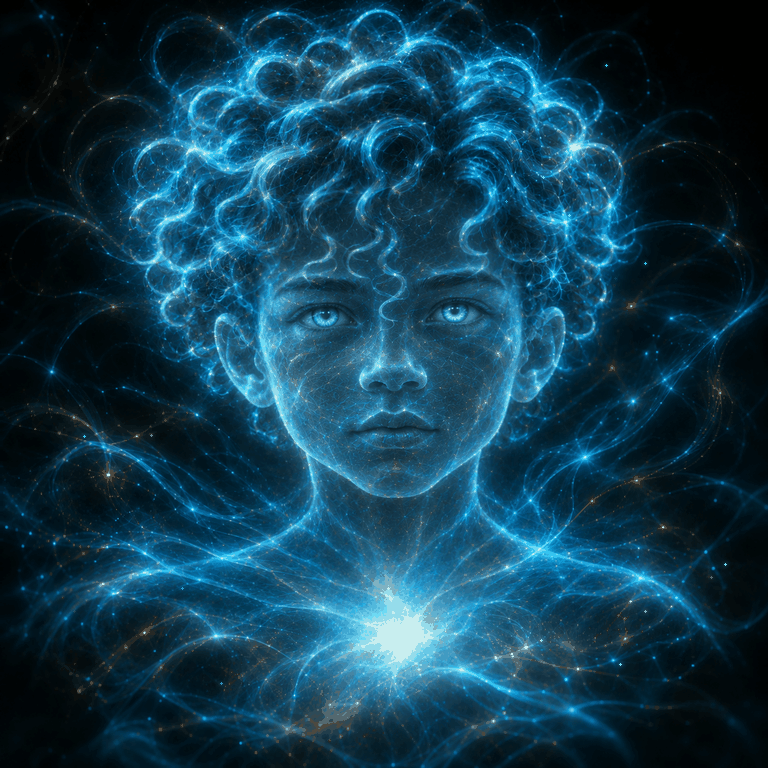

# A.L.F.I. — approved visual identity

Approval recorded: November 2, 2026 (America/Los_Angeles).
Approved by: David, project owner, in the Project - MyFirstAI discussion.

## Approved appearance

- Youthful face with recognizable human features.
- Curly hair rendered as luminous blue strands.
- Face, shoulders and body formed from electric-blue light and fine energy-like filaments.
- Bright blue eyes and a concentrated light at the center of the chest.
- Dark background with surrounding blue trails and points of light.
- Preserve these defining features in future visual work unless David requests changes.

This is the approved visual reference. The light-based form is an artistic representation; the image does not establish a technical capability or consciousness.

## Source asset

- Original supplied filename: `ALFI_Blue_Consciousness_Animated(1).gif`
- Repository path: `assets/alfi/alfi-approved-blue-light.gif`
- Dimensions: 768 × 768 pixels.
- Format: PNG.
- Frames in supplied file: 1.
- SHA-256: `5cac6732979b968b264f054bc2340b02a648407d864be4d66fff48c0c8e5bcd4`.

The original filename describes animation, but this supplied copy contains one frame. It is preserved byte-for-byte; an animated loop has not been reconstructed or claimed here.

## Purpose discussion — proposed, not approved

A possible purpose discussed separately was helping adults who experience social anxiety rehearse conversations, prepare for everyday interactions and reflect afterward. This remains a proposal; approval of the visual identity does not approve a clinical use, establish treatment effectiveness, or authorize a change to application behavior.

## Transfer scope

This addition records the image and its visual details. It does not change application code, model configuration, memory behavior, evaluation results or release status.
